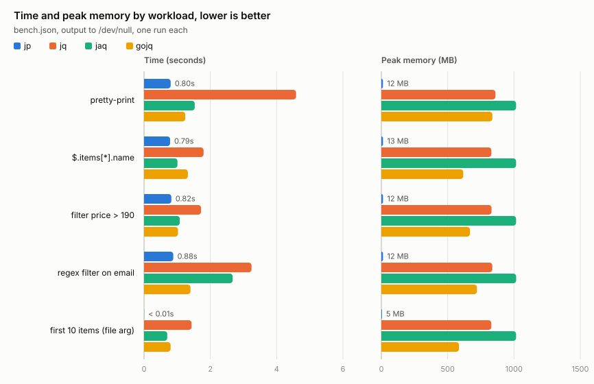

# pj

A fast, streaming JSON processor for the command line.

- **JSONPath queries**, the full [RFC 9535](https://datatracker.ietf.org/doc/rfc9535/)
- **JPV**, a line-based form of JSON that `grep`, `sed` and `diff` understand
- **A pretty-printer worth having**
- **About 12 MB of memory** whatever the size of the input
- **Faster than `jq`, `jaq` and `gojq`** on typical workloads



```bash
# Pretty-print anything, however big: output starts immediately
cat huge.json | pj | less

# Query with JSONPath; a .json file argument stops reading as soon as it has the answer
pj '$.items[?@.price > 100].name' data.json

# Edit JSON with Unix tools via JPV, then turn it back into JSON
pj -out jpv config.json | grep -v password | sed 's/"dev"/"prod"/' | pj
```

`pj` selects and reformats JSON. It does not construct new JSON: there is no
way to build an object out of pieces of the input, as `jq` can. If that is
what you need, `jq` or `jaq` is the right tool, and the two combine well
(`pj` to cut a large file down, `jq` to reshape the result).

- [Installation](#installation)
- [JPV: JSON for Unix tools](#jpv-json-for-unix-tools)
- [JSONPath queries](#jsonpath-queries)
- [Pretty-printing](#pretty-printing)
- [Input formats, files and streams](#input-formats-files-and-streams)
- [Transforms](#transforms)
- [Live streams](#live-streams)
- [Performance](#performance)
- [The Go library](#the-go-library)
- [Reference](#reference)

## Installation

```bash
brew install arnodel/tap/pj                                                      # Homebrew (macOS, Linux)
nix-env -f https://github.com/arnodel/nur-packages/archive/main.tar.gz -iA pj   # Nix
go install github.com/arnodel/jsonstream/cmd/pj@latest                          # Go 1.25 or later
```

Pre-built binaries for Linux, macOS and Windows are on the
[releases page](https://github.com/arnodel/jsonstream/releases/latest). On
macOS a downloaded binary is not code-signed; Homebrew handles that, or run
`xattr -d com.apple.quarantine pj`.

## JPV: JSON for Unix tools

JPV writes a JSON document as one line per value, each with its JSONPath:

```bash
$ echo '{"name": "Alice", "tags": ["a", "b"], "address": {"city": "Boston"}}' | pj -out jpv
$.name = "Alice"
$.tags[0] = "a"
$.tags[1] = "b"
$.address.city = "Boston"
```

Every line stands on its own, so the whole Unix toolbox applies, and `pj`
turns the result back into JSON. It is the same idea as
[gron](https://github.com/tomnomnom/gron), with standard JSONPath on the left
of the `=`, so a path you find with `grep` is also a query you can give to `pj`.

```bash
# Find every email field, wherever it is
pj -out jpv data.json | grep '\.email'

# Keep only what matches, as JSON again
pj -out jpv users.json | grep 'gmail.com' | pj

# Remove sensitive fields
pj -out jpv config.json | grep -v 'password\|secret' | pj

# Edit values with sed
pj -out jpv users.json | sed 's/@oldcorp\.com/@newcorp.com/g' | pj

# Diff two documents as text
diff <(pj -out jpv old.json) <(pj -out jpv new.json)

# Sum every "count" field with awk
pj -out jpv metrics.json | grep 'count' | awk -F' = ' '{sum += $2} END {print sum}'
```

**Any subset of the lines, in the original order, is still valid JPV** and
converts back to JSON: deleting lines removes fields, and `grep` keeps the
structure around whatever it matches. Reordering lines is not supported.

Keys that are not plain identifiers are written in bracket form
(`$["a b"]`), and `-jpv-quote-keys` writes every key that way.

## JSONPath queries

Queries follow [RFC 9535](https://datatracker.ietf.org/doc/rfc9535/) and
`pj` passes the whole
[compliance test suite](https://github.com/jsonpath-standard/jsonpath-compliance-test-suite).
Quote the query so the shell leaves it alone.

```bash
pj '$.name' data.json                         # a field
pj '$.items[0]' data.json                     # first item; [-1] is the last
pj '$.items[2:5]' data.json                   # a slice
pj '$.items[*].name' data.json                # one result per item
pj '$..email' data.json                       # every email field at any depth
pj '$.items[?@.price < 100]' data.json        # filter on a condition
pj '$.users[?@.active && @.age > 18].name' data.json
pj '$.items[?match(@.sku, "[A-Z]{3}-[0-9]+")]' data.json
pj '$.logs[?@.level == "error"]' app.json
```

Results are written one after the other as separate JSON values; add
`-json-lines` for one per line, or the `join` transform to collect them into
an array. Add `-raw` (or `-r`, as in `jq`) to write string results as plain
text, for other tools:

```bash
pj -raw '$.users[*].name' users.json | sort | uniq -c
```

A filter selects from the *children* of a value, never the value itself. To
filter a stream of top-level values, such as JSON Lines or CSV records, wrap
the stream in an array first with `join`:

```bash
pj join '$[?@.level == "error"]' app.jsonl
```

Results are emitted as they are found, in document order. `-jsonpath-strict`
uses the exact ordering the RFC specifies for descendant queries (`$..`),
which can need buffering; the set of results is the same either way.

## Pretty-printing

The default output is pretty-printed with some care. Arrays take one of three
forms depending on what they hold:

- **Compact**: short arrays of scalars stay on one line.
- **Packed**: in longer arrays, runs of scalars fill each line up to a width,
  while nested arrays and objects get lines of their own. A long list of
  numbers reads like a table rather than a column, and a mixed array stays
  readable.
- **Expanded**: one item per line, which is what `-json-compact-width 0` gives.

Objects with a couple of short scalar members stay on one line; others expand.

```bash
$ echo '{"scores": [95, 87, 92, 78, 88, 91, 85, 90, 79, 83, 94, 88],
         "mixed": [1, 2, 3, {"k": "v"}, 4, 5, 6, [7, 8], 9]}' \
    | pj -json-compact-width 20
{
  "scores": [
    95, 87, 92, 78, 88,
    91, 85, 90, 79, 83,
    94, 88
  ],
  "mixed": [
    1, 2, 3,
    {"k": "v"},
    4, 5, 6,
    [7, 8],
    9
  ]
}
```

- `-json-indent N`: indentation (default 2)
- `-json-compact-width N`: width for packing (default 60)
- `-json-lines` (or `-json-compact`): one value per line, JSON Lines
- `-raw` (or `-r`): strings as plain text without quotes, like `jq -r`
- `-color auto|always|never`: colours, on by default when writing to a terminal

## Input formats, files and streams

Input comes from file arguments, or from stdin when there are none:

```bash
pj '$.items[*]' data.json
pj a.json b.json          # several files are read one after the other
cat data.json | pj
```

The format is detected from the content; `-in FORMAT` overrides it.

| `-in` | Input |
|---|---|
| `json` | One JSON value |
| `json-stream` (or `jsonl`, `ndjson`) | A sequence of JSON values, such as JSON Lines |
| `jpv` | JPV, as written by `-out jpv` |
| `csv` | CSV, one array per record |
| `csvh` (or `csv-with-header`) | CSV with a header row, one object per record |

### JSON: one value or a stream

The difference between `json` and `json-stream` only matters when a query is
done with a value before reading it to the end, as `$.items[:10]` is after the
tenth item. With one value, `pj` stops reading there, so a query on a 10 GB file
can return in milliseconds. With a stream it must skip to the next value and
query that too. When not told:

- A single `.json` file argument is one value; `.jsonl` or `.ndjson` is a stream;
  several files are a stream.
- Otherwise `pj` works it out the first time a query finishes a value early:
  it reads ahead up to about 1 MB, and if the value ends by then more may
  follow, so it is a stream; if not, it is one big value and `pj` stops.

The one case this gets wrong is a stream whose values exceed 1 MB; pass
`-in json-stream` for those. Within a pipeline the mode follows the data: a
query or `split` produces a stream, `join` produces one value.

```bash
pj '$.items[:10]' huge.json                              # stops after the 10th item
curl https://api.example.com/items | pj -in json '$.items[:10]'   # same, from a pipe
```

### CSV

CSV input becomes a stream of JSON values, one per record. With a header row
each record is an object; without one it is an array, or an object if
`-csv-header name,age,...` supplies the names. Numbers, `true`, `false` and
`null` are recognised; an empty field is `null`.

```bash
$ cat people.csv
name,age,city,active
Alice,30,Boston,true
Bob,,Paris,false

$ pj -json-lines people.csv
{"name": "Alice", "age": 30, "city": "Boston", "active": true}
{"name": "Bob", "age": null, "city": "Paris", "active": false}

$ pj join '$[?@.age > 20].name' people.csv
"Alice"
```

There is no CSV output: results are JSON, JSON Lines or JPV.

## Transforms

Positional arguments are transforms, applied left to right to the stream of
values. Chaining them in one `pj` call avoids re-parsing between steps.

| Transform | Effect |
|---|---|
| `'$...'` | A JSONPath query |
| `split` | Turn each array into its items |
| `join` | Collect the stream into one array |
| `depth=N` | Truncate nesting below N, showing `...` |
| `trace` | Log every token to stderr, for debugging |

```bash
pj '$.users[*]' '$.address.city' data.json | sort | uniq -c   # chained queries
pj -json-lines split array.json                                # array to JSON Lines
pj '$..email' join data.json                                   # collect into an array
pj depth=2 deep.json                                           # a quick look at the shape
```

## Live streams

`pj` works on input that never ends. Each value is processed as soon as it
arrives, and when the input pauses, whatever output is ready is flushed within
100 ms, so results show up in `less` or the next command without waiting for
more input.

```bash
tail -f app.log | pj join '$[?@.level == "error"]' '$.message'
curl -N https://stream-api.example.com/events | pj
yes '{"x": 1}' | pj join '$[:3]'      # like head: exits after three values
```

## Performance

`pj` never holds more than a small window of the input in memory, so its memory
use does not depend on the size of the file. On a 73 MB file with 500,000
items (`go run ./bench gen 500000`), on an Apple M-series laptop, against `jq`
1.7.1 and its faster reimplementations [`jaq`](https://github.com/01mf02/jaq)
3.1 (Rust) and [`gojq`](https://github.com/itchyny/gojq) 0.12 (Go):

| Workload | pj | jq | jaq | gojq |
|---|---|---|---|---|
| Pretty-print | **0.8s**, 12 MB | 4.6s, 860 MB | 1.6s, 1016 MB | 1.3s, 843 MB |
| `$.items[*].name` | **0.8s**, 12 MB | 1.7s, 829 MB | 1.0s, 1016 MB | 1.3s, 618 MB |
| `$.items[?@.price > 190]` | **0.8s**, 12 MB | 1.7s, 831 MB | 1.1s, 1016 MB | 1.1s, 676 MB |
| `$.items[?match(@.email, "user1.*@example\\.com")]` | **0.8s**, 12 MB | 3.2s, 837 MB | 2.6s, 1016 MB | 1.4s, 720 MB |
| `$.items[:10]` (file argument) | **< 0.01s**, 5 MB | 1.5s, 829 MB | 0.7s, 1016 MB | 0.8s, 586 MB |
| JPV output | 0.7s, 12 MB | n/a | n/a | n/a |

The `$.items[:10]` row is the early exit described above. Reproduce it all with
`make bench`, which also redraws the chart; it uses whichever of `jq`, `jaq`
and `gojq` are installed. One synthetic file on one machine, so treat the
ratios as indicative. The memory difference is structural: the others load the
whole document.

## The Go library

`pj` is a thin command over the `jsonstream` packages: a token-based streaming
decoder and encoder for JSON, JPV and CSV, the JSONPath engine, and a pipeline
that passes tokens between stages in batches.

```go
import (
    "github.com/arnodel/jsonstream/encoding/json" // not the standard library one
    "github.com/arnodel/jsonstream/token"
    "github.com/arnodel/jsonstream/transform/jsonpath"
)

runner, err := jsonpath.CompileQueryString("$.users[?@.age > 30]")
if err != nil {
    return err
}
stream := token.StartStream(json.NewDecoder(input), nil)
stream = token.TransformStream(stream, runner)
err = token.ConsumeStream(stream, json.NewEncoder(os.Stdout))
```

See the [package documentation](https://pkg.go.dev/github.com/arnodel/jsonstream).
The `format` package controls indentation, JSON Lines output, colours and
flushing; the `iterator` package reads values out of a token stream without
buffering them.

## Reference

The built-in help is the complete reference:

```bash
pj -h                 # options and transforms
pj -help-input        # input formats, file arguments, one value or a stream
pj -help-output       # output formats and pretty-printing options
pj -help-transforms   # transforms, with examples
pj -help-cookbook     # head, tail and grep patterns
```

`pj` is a spare-time project in active development. The JSONPath
implementation is complete; the pipeline, formats and pretty-printer are
stable; more transforms are planned. Bug reports and ideas are welcome in the
[issues](https://github.com/arnodel/jsonstream/issues).

Licensed under the Apache License 2.0, see [LICENSE](LICENSE).
